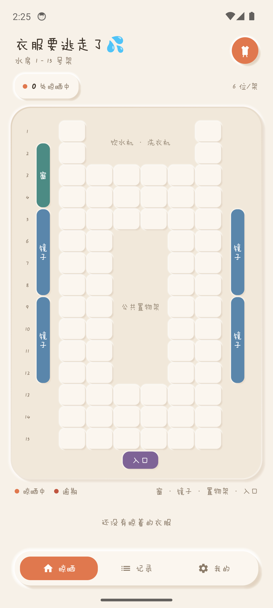
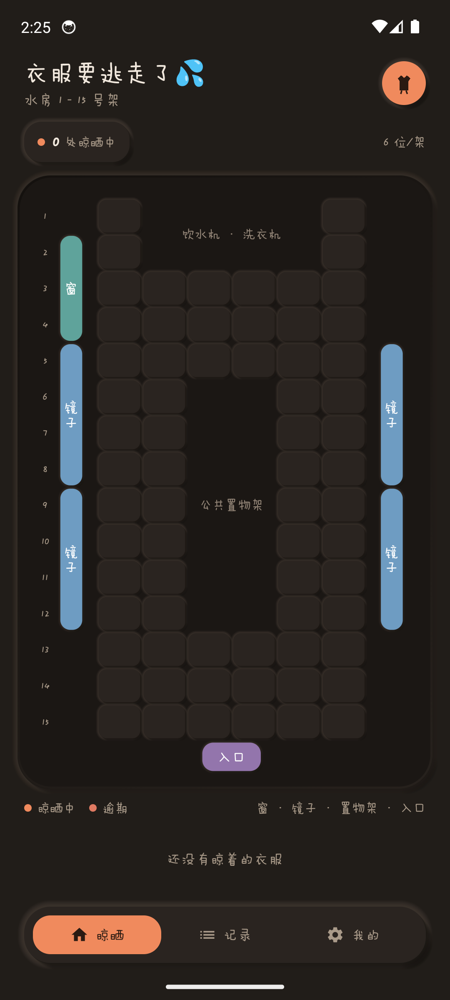

# 衣服要逃走了 💦

> 公共水房晾衣记录 + 收衣提醒 App。纯本机离线，无网络权限。

住宿舍的人大概都经历过：衣服晾在公共水房，隔了两三天去收，发现少了一件——不记得哪天晾的、晾在几号架、晾了哪几件，更别提找回来。

这个 App 把「晾在哪 + 晾了哪几件 + 几天后提醒你收 + 衣服现在什么状态」串成一件事。

<p align="center">
  
  
</p>

## 为什么自己做

市面上的产品只覆盖其中一到两项：

| 产品 | 覆盖 | 缺什么 |
|---|---|---|
| [Sundry](https://www.ingbale.com/sundry/en) | 按布料/位置/天气估算干燥时间并到点通知 | 位置只是"类别"，记不住 3 号架；不知道晾了哪几件 |
| [wardove](https://github.com/zorenkonte/wardove) | 衣服库 + 脏/洗/净状态机 | 没有晾晒位，没有 N 天后定时提醒 |
| [心橱](https://xinchu.app/) | 衣物按存放位置归类 + 穿搭日历 | 仅 iOS；无晾晒位、无倒计时 |
| [z衣橱](https://zyichu.com/) / [尽简衣橱](https://closet.jinjian.tech/) | 不限量衣橱、自动搭配、单次成本 | 定位是穿搭，不追踪"现在晾在哪" |
| [hausync](https://www.hausync.com/guides/laundry-tracker-for-shared-houses) / Share the Load | 共享洗衣机排班 | 没有晾衣位与衣物归属 |

「这件衣服现在晾在哪个架子」这一环没人做，所以自建。

## 功能

- **选位看板**：15 个晾衣架 × 每架 N 个格位（4–12 可调）。长按拖动圈出一块矩形区域，松手建单；单击可只占一个位置
- **房间参照物**：按实际水房平面图标出窗、四面镜子、入口；饮水机·洗衣机与公共置物架的位置**完全留空**，只有一行浅色文字，划选时自动跳过
- **多条记录并存**：每条记录独立配色，一格位只归属一条活跃记录，冲突格自动跳过并提示
- **到期提醒**：`AlarmManager` 精确闹钟，通知带「已收」快捷操作；重启/升级后自动重建
- **逾期晃动**：过了收衣时间的区域在图上高频抖动 + 红框呼吸 + 角标，直到收回
- **现场照片**：拍照或相册，压到长边 1600px 存本机，可作被错收时的凭据
- **记录与统计**：按日分组、本月次数、平均晾晒时长、丢失次数、最易丢的架子
- **新拟物界面**：暖奶油浅色 / 暖炭深色，跟随系统或手动切换；看板是凹陷托盘，格位是凸起按键
- **备份**：导出/导入 JSON，换机可迁移

## 技术栈

Kotlin 2.0.21 · AGP 8.5.2 · Jetpack Compose（BOM 2024.06.00）· Material 3 · Coil

`minSdk 26` / `targetSdk 34`；SQLiteOpenHelper 手写持久化（无 Room/KSP）；单 Activity + sealed 状态导航；`compileSdk 34`。

## 构建

需要 JDK 17+、Android SDK（platform 34、build-tools 34+）。

```bash
git clone <this repo>
cd clothes-escape
echo "sdk.dir=/path/to/Android/sdk" > local.properties

gradle assembleDebug          # 产物 app/build/outputs/apk/debug/app-debug.apk
gradle testDebugUnitTest      # 单元测试
gradle lintDebug              # 静态检查
```

依赖走阿里云 / 腾讯镜像（见 `settings.gradle.kts`），因为 Maven Central 直连会 403。

## 字体

界面与看板标注使用 **方正喵呜_GBK**。出于授权原因，字体文件**未包含在仓库中**。

若要获得与截图一致的字形，请自行准备已获授权的字体文件放到：

```
app/src/main/assets/fonts/fzmiaowu_gbk.ttf
```

缺失时 `AppFonts` 会静默回退到系统字体，不会崩溃。**请勿将商业字体提交到本仓库。**

## 结构

```
app/src/main/java/com/sfyz/clothesescape/
  data/      模型、SQLite、仓库、设置、统计、时间工具
  notify/    闹钟调度、提醒/收衣/开机广播、通知
  ui/board/  看板几何（纯函数，可单测）+ Canvas 绘制 + 手势
  ui/theme/  双色板、新拟物柔和投影、字体
  ui/        首页、新建弹窗、详情、记录、设置
  util/      图片压缩、备份
```

## 已知边界

- 国产 ROM 需手动允许自启动/后台运行，否则闹钟可能被吞（设置页有引导）
- 精确闹钟未授权时降级为近似闹钟
- 照片存应用私有目录，卸载即丢失；换机前请先导出备份
- 水房布局（15 个架子、窗/镜/置物架/入口的位置）写在 `BoardLandmarks.kt` 里，换房间改这一个文件即可

## License

[MIT](LICENSE)
